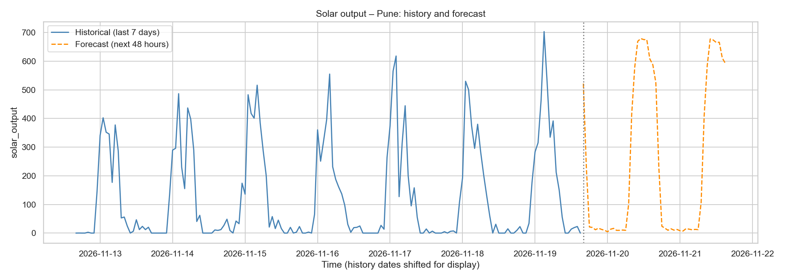
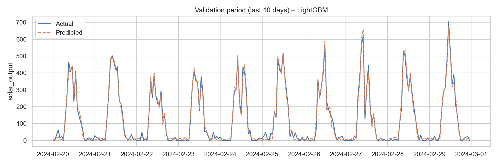

# Solar Power Prediction Application

An end-to-end machine-learning project that predicts hourly solar power output for Pune, Maharashtra (18.52° N, 73.86° E).

The project:
- Cleans a 60-day hourly dataset.
- Engineers time-based features.
- Compares three regression models.
- Fetches a live 48-hour weather forecast.
- Predicts future solar output.
- Serves results through a Jupyter notebook, a Streamlit web app, and a FastAPI REST API.

> **Docker is not required.** This project runs directly with Python.

## Screenshots

**Final visualization – historical data + 48-hour forecast**



**Model check – actual vs predicted on the 10 validation days**



Both images are created when you run the notebook. An interactive version is saved as `outputs/solar_forecast_interactive.html`.

---

## What the project does

| Step | Description |
|---|---|
| 1. Data | Generates the assignment dataset with the exact script from the brief (seed 42): 1,440 hourly rows, from 1 January to 29 February 2024. |
| 2. Cleaning | Parses timestamps, sorts the data, removes duplicate hours, rebuilds a complete hourly timeline, interpolates gaps, and clips values to valid ranges. |
| 3. Features | Creates hour, sine/cosine of hour, day of week, and weekend flag features. |
| 4. Split | Uses a chronological split: first 50 days for training and last 10 days for validation (no shuffling). |
| 5. Training | Trains Random Forest, XGBoost, and LightGBM, each tuned with `GridSearchCV` and `TimeSeriesSplit`. |
| 6. Evaluation | Calculates MAE, RMSE, and R² on the 10 validation days; saves the selected model with `joblib`. |
| 7. Live API | Retrieves a 48-hour hourly forecast for Pune from Open-Meteo and formats it to match the model's feature schema. |
| 8. Prediction | Applies the same feature function to the forecast and clips predictions at 0. |
| 9. Output | Produces static and interactive charts, a 24-hour table, a web app, and a REST API. |

## Project structure

```text
solar-power-prediction/
├── Solar_Power_Prediction.ipynb   # Step-by-step walkthrough of the workflow
├── solar_core.py                  # Shared data, feature, weather API, and prediction code
├── train.py                       # Training script (tune, evaluate, save model)
├── api.py                         # FastAPI REST API
├── app.py                         # Streamlit web app
├── requirements.txt               # Python dependencies
├── .gitignore
├── README.md
│
│   Created when you run the notebook or train.py:
├── solar_weather_dataset.csv      # Generated 60-day dataset
├── last_forecast.csv              # Last good API response (fallback if API is down)
├── models/
│   └── solar_model.joblib         # Model, feature list, and training medians
└── outputs/
    ├── model_metrics.json
    ├── solar_forecast_chart.png
    ├── validation_actual_vs_predicted.png
    ├── solar_forecast_interactive.html
    ├── solar_predictions.csv
    └── sample_24h_predictions.csv
```

The notebook is the readable walkthrough (data → model → forecast → charts). `solar_core.py` contains reusable functions, so `train.py`, `api.py`, and `app.py` use the same data, feature, and weather-API logic. `train.py` reproduces the notebook's model and metrics from the command line.

## Setup and run (without Docker)

### Requirements

- Python 3.10 or newer
- `pip`
- An internet connection for installing packages and retrieving the live weather forecast

No Docker installation, Dockerfile, or container is needed.

### 1. Open the project folder

Open a terminal (Command Prompt, PowerShell, or a terminal on macOS/Linux) and change to the directory containing `requirements.txt`.

### 2. Create and activate a virtual environment

**Windows — Command Prompt**

```bat
python -m venv venv
venv\Scripts\activate
```

**Windows — PowerShell**

```powershell
python -m venv venv
.\venv\Scripts\Activate.ps1
```

**macOS / Linux**

```bash
python3 -m venv venv
source venv/bin/activate
```

If PowerShell blocks activation, use Command Prompt or follow your system's PowerShell execution-policy guidance.

### 3. Install dependencies

```bash
python -m pip install --upgrade pip
pip install -r requirements.txt
```

### 4. Train the model

```bash
python train.py
```

This runs the training workflow, compares the models, evaluates them, and saves the selected model under `models/`.

Alternatively, open `Solar_Power_Prediction.ipynb` in Jupyter and choose **Run → Run All Cells**. The notebook also creates the charts and tables in `outputs/`. An internet connection is needed for the weather-API step.

### 5. Start the Streamlit web app

```bash
streamlit run app.py
```

Open [http://localhost:8501](http://localhost:8501) in your browser.

### 6. Start the FastAPI backend (optional)

Open a second terminal, change to the project folder, and activate the same virtual environment. Then run:

```bash
uvicorn api:app --reload
```

Open [http://127.0.0.1:8000/docs](http://127.0.0.1:8000/docs) for the interactive Swagger documentation.

The Streamlit app and FastAPI server are separate processes. Keep each terminal open while using the corresponding service. You can run the web app, the API, or both.

## Quick start commands

After activating the virtual environment and installing dependencies:

```bash
# Train and save the model
python train.py

# Streamlit frontend
streamlit run app.py

# FastAPI backend (optional; run in a second terminal)
uvicorn api:app --reload
```

## API key

No API key is needed. The project uses Open-Meteo, which is free for non-commercial use and requires no sign-up.

If you switch to a keyed weather API (for example, OpenWeatherMap or WeatherAPI), store the key in a `.env` file, keep `.env` in `.gitignore`, and never commit it.

## Weather API

| Item | Details |
|---|---|
| API | Open-Meteo Forecast API |
| Endpoint | `https://api.open-meteo.com/v1/forecast` |
| Access | No sign-up, account, or API key required |
| Why this API | Free tier, no key to leak, hourly data for 3 days, supports a timezone and m/s wind speed |
| Fields used | `temperature_2m`, `relative_humidity_2m`, `cloud_cover`, `wind_speed_10m`, `precipitation` |
| Settings | `timezone=Asia/Kolkata`, `wind_speed_unit=ms`, `forecast_days=3` (only the next 48 hours from the current hour are used) |

## Error handling

| Problem | What the code does |
|---|---|
| Network error, timeout, or bad response | Retries up to 3 times with increasing wait. |
| Rate limit (HTTP 429) | Waits (uses `Retry-After` when present) and retries. |
| A few missing hourly values | Uses linear interpolation between neighbouring hours. |
| A whole field missing from the response | Fills it with the median of the training data. |
| Out-of-range values | Clips humidity and cloud cover to 0–100. |
| API completely down | Uses the last saved forecast (`last_forecast.csv`); the app and API identify the data as saved. |
| API down and nothing saved | Returns a clear error message (HTTP 503 from the REST API). |
| Too many requests | Caches live forecasts for 10 minutes in the app and API. |

## Feature engineering

| Feature | Why it is used |
|---|---|
| `temperature`, `humidity`, `cloud_cover`, `wind_speed`, `precipitation` | Weather inputs available both historically and in the forecast. |
| `hour` (0–23) | Solar output depends strongly on time of day. |
| `hour_sin`, `hour_cos` | Represents hours on a circle, so 23:00 and 00:00 are treated as neighbours. |
| `day_of_week`, `is_weekend` | Calendar features requested in the brief. |

A single function, `add_time_features()`, builds these features for both historical data and the API forecast, so the two always have the same columns and order.

## Model training and evaluation

### Split (chronological, no shuffling)

| Set | Rows | Period |
|---|---:|---|
| Training | 1,200 (50 days) | 1 Jan 2024 – 19 Feb 2024 |
| Validation | 240 (10 days) | 20 Feb 2024 – 29 Feb 2024 |

Each model is tuned with a small grid using `TimeSeriesSplit` (3 folds) inside the 50 training days only. The validation days are not used during tuning. The model with the lowest cross-validation RMSE is selected.

### Results on the 10 validation days

| Model | CV RMSE (train) | MAE | RMSE | R² |
|---|---:|---:|---:|---:|
| LightGBM (selected) | 22.74 | 15.32 | 20.26 | 0.9852 |
| XGBoost | 23.02 | 15.36 | 20.98 | 0.9842 |
| Random Forest | 25.84 | 15.07 | 20.71 | 0.9846 |

Best parameters for LightGBM: `n_estimators=200`, `num_leaves=15`.

All three models perform very similarly. Random Forest has the lowest MAE, but LightGBM was selected because it had the lowest cross-validation RMSE on the training days. This selection rule was set before looking at validation scores. Results can vary slightly with library versions.

**Units:** `solar_output` is in arbitrary units on a ~kW scale (as defined in the assignment), so MAE and RMSE are in the same units.

## Sample output

### A. Live forecast — next 24 hours

Live Open-Meteo forecast for Pune, generated on 19 Nov 2026 (source: `outputs/sample_24h_predictions.csv`). Values are in the dataset's arbitrary units (~kW scale). A new run produces a new table, because it depends on the forecast on the day you run the project.

| Date and time | Predicted output |
|---|---:|
| 19 Nov 2026 16:00 | 521.73 |
| 19 Nov 2026 17:00 | 226.94 |
| 19 Nov 2026 18:00 | 21.44 |
| 19 Nov 2026 19:00 | 19.39 |
| 19 Nov 2026 20:00 | 11.60 |
| 19 Nov 2026 21:00 | 17.01 |
| 19 Nov 2026 22:00 | 12.82 |
| 19 Nov 2026 23:00 | 9.87 |
| 20 Nov 2026 00:00 | 4.39 |
| 20 Nov 2026 01:00 | 13.36 |
| 20 Nov 2026 02:00 | 16.38 |
| 20 Nov 2026 03:00 | 9.41 |
| 20 Nov 2026 04:00 | 9.51 |
| 20 Nov 2026 05:00 | 10.58 |
| 20 Nov 2026 06:00 | 9.64 |
| 20 Nov 2026 07:00 | 102.20 |
| 20 Nov 2026 08:00 | 413.94 |
| 20 Nov 2026 09:00 | 578.03 |
| 20 Nov 2026 10:00 | 669.31 |
| 20 Nov 2026 11:00 | 678.94 |
| 20 Nov 2026 12:00 | 675.41 |
| 20 Nov 2026 13:00 | 675.06 |
| 20 Nov 2026 14:00 | 608.11 |
| 20 Nov 2026 15:00 | 587.61 |

### B. Validation sample — last 24 hours of the dataset

Actual vs. predicted values for 29 February 2024:

| Date and time | Actual | Predicted |
|---|---:|---:|
| 29 Feb 2024 00:00 | 0.00 | 1.12 |
| 29 Feb 2024 01:00 | 0.00 | 13.15 |
| 29 Feb 2024 02:00 | 9.59 | 7.11 |
| 29 Feb 2024 03:00 | 22.58 | 4.14 |
| 29 Feb 2024 04:00 | 0.00 | 2.74 |
| 29 Feb 2024 05:00 | 0.00 | 4.53 |
| 29 Feb 2024 06:00 | 33.95 | 9.78 |
| 29 Feb 2024 07:00 | 176.95 | 181.99 |
| 29 Feb 2024 08:00 | 283.13 | 295.12 |
| 29 Feb 2024 09:00 | 315.26 | 311.91 |
| 29 Feb 2024 10:00 | 462.83 | 428.13 |
| 29 Feb 2024 11:00 | 703.32 | 674.97 |
| 29 Feb 2024 12:00 | 526.49 | 504.79 |
| 29 Feb 2024 13:00 | 334.65 | 315.97 |
| 29 Feb 2024 14:00 | 391.44 | 342.75 |
| 29 Feb 2024 15:00 | 212.24 | 260.54 |
| 29 Feb 2024 16:00 | 150.01 | 145.15 |
| 29 Feb 2024 17:00 | 55.23 | 45.92 |
| 29 Feb 2024 18:00 | 0.00 | 5.98 |
| 29 Feb 2024 19:00 | 0.00 | 8.27 |
| 29 Feb 2024 20:00 | 13.86 | 6.52 |
| 29 Feb 2024 21:00 | 19.22 | 0.00 |
| 29 Feb 2024 22:00 | 22.93 | 13.68 |
| 29 Feb 2024 23:00 | 0.00 | 14.03 |

## Web application

Run:

```bash
streamlit run app.py
```

The app provides:
- Live 48-hour forecast with peak output, 24-hour total, productive hours, average cloud cover, and temperature.
- Interactive Plotly chart (past 7 days + next 48 hours, or forecast only).
- Hourly table for the next 24 or 48 hours, including the weather inputs used.
- CSV download of predictions.
- Model name and validation MAE, RMSE, and R².
- Warning banner if the API is down and the last saved forecast is being shown.

## REST API (FastAPI)

Start the API:

```bash
uvicorn api:app --reload
```

Then open [http://127.0.0.1:8000/docs](http://127.0.0.1:8000/docs) for interactive documentation (Swagger UI).

| Method | Endpoint | Description |
|---|---|---|
| GET | `/health` | Checks whether the server is running and the model is loaded. |
| GET | `/model` | Returns the selected model, feature list, and validation metrics. |
| GET | `/forecast?hours=24` | Fetches the Pune weather forecast and predicts solar output for the next 1–48 hours. |
| POST | `/predict` | Predicts solar output for weather values you send (does not call the weather API). |

### Example — forecast

```bash
curl "http://127.0.0.1:8000/forecast?hours=3"
```

The response has this shape (values depend on the live forecast):

```json
{
  "location": "Pune, Maharashtra, India (18.52, 73.86)",
  "source": "live",
  "hours": 3,
  "unit_note": "solar_output is in arbitrary units on a ~kW scale (as defined in the assignment)",
  "predictions": [
    {
      "timestamp": "2026-11-20T10:00",
      "predicted_solar_output": 528.49,
      "temperature": 29.1,
      "humidity": 48.0,
      "cloud_cover": 20.0,
      "wind_speed": 3.2,
      "precipitation": 0.0
    }
  ]
}
```

### Example — custom weather

```bash
curl -X POST "http://127.0.0.1:8000/predict" \
  -H "Content-Type: application/json" \
  -d '[{"timestamp":"2026-11-20T12:00","temperature":30,"humidity":50,"cloud_cover":10,"wind_speed":3,"precipitation":0}]'
```

Inputs are validated (for example, humidity 0–100 and hours 1–48). Invalid requests return HTTP 422. If the weather API is down, the endpoint falls back to the last saved forecast (`"source": "saved"`). If nothing is saved, it returns HTTP 503.

## Design decisions and assumptions

1. **Dataset:** Uses the exact script from the assignment, so results are reproducible (`np.random.seed(42)`).
2. **Chronological split:** Uses 50 days for training and 10 days for validation, matching the brief. Shuffling would leak future information into training.
3. **No leakage in tuning:** `TimeSeriesSplit` is applied only inside the training days; validation data is used once, for the final scores.
4. **Model choice:** Compares three tree-based models; selection uses cross-validation RMSE, not validation scores.
5. **Missing data:** Uses interpolation for small gaps (weather changes smoothly hour to hour) and the training median if a whole API field is missing.
6. **Timezone:** Treats dataset hours and API data as local time. The API is requested with `Asia/Kolkata`.
7. **Forecast window:** The API returns 3 days starting at midnight; only hours from the current hour onwards are kept (48 hours).
8. **No negative output:** Clips predictions with `np.clip(pred, 0, None)`.
9. **Feature consistency:** Uses one shared feature function and a saved feature list to keep training and forecast columns identical in the notebook, app, and API.
10. **Modular code:** Shared logic lives in `solar_core.py`; `train.py`, `api.py`, and `app.py` are thin entry points.
11. **Chart:** The data is from Jan–Feb 2024, but the forecast is for the current day. To show them on one continuous line, the history's dates are shifted for display only. The data and model are unchanged, and the chart labels explain this.

## Limitations

- The dataset is synthetic (generated from a formula), so the scores show how well the model learned this data, not real solar-plant accuracy.
- In the assignment's generator, night-time output is `max(0, random noise)`, so it is a small positive number about half the time. The model learns this, so night predictions can be small positive values rather than exactly 0.
- Training temperature follows a simple sine curve, so real forecast temperatures (for example, a cool winter morning) can differ from what the model saw.
- Panel orientation, shading, inverter losses, and plant-specific data are not modelled. A real deployment would need measured generation history and ongoing validation.
- There is no automated test suite yet.

## Bonus features included

- Comparison of three models (Random Forest, XGBoost, LightGBM).
- Interactive Plotly chart (notebook and app).
- REST API with FastAPI (`/forecast`, `/predict`, `/model`, `/health`).
- Cached and rate-limit-aware API calls: 10-minute cache, retries with back-off, HTTP 429 handling, and saved-forecast fallback.
- Streamlit web app with CSV download.

## Tech stack

Python · pandas · NumPy · scikit-learn · XGBoost · LightGBM · Plotly · Matplotlib · Streamlit · FastAPI · Uvicorn · Open-Meteo API
